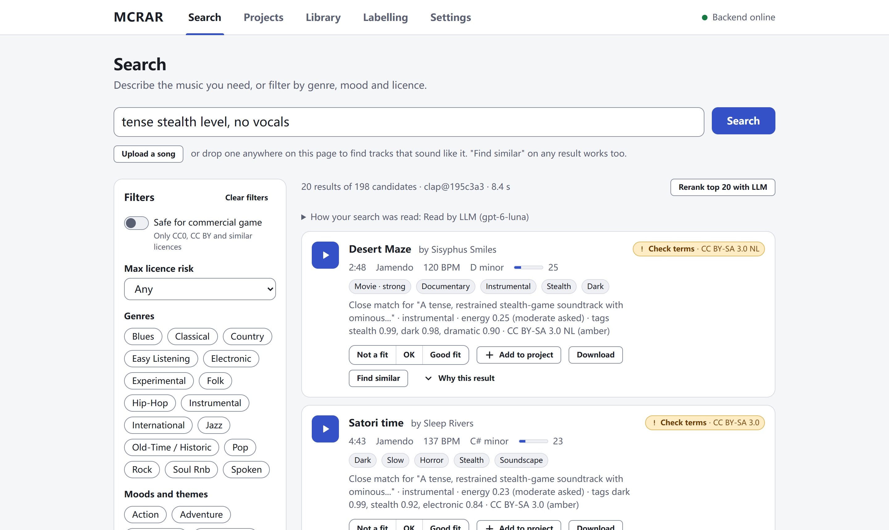
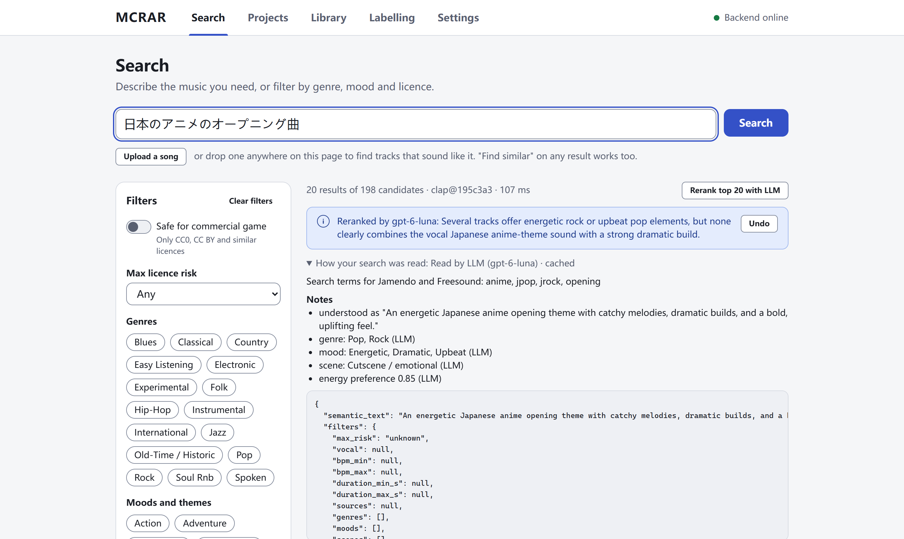

# MCRAR

**Find music by describing it.** MCRAR is a music recommender for listeners and indie game
developers. Type what you need ("tense stealth level, no vocals", "cozy town theme") or point
at a song you like, and it searches royalty-free catalogs and your own folders by how the music
*sounds*. Every result shows its licence, so you can tell at a glance what you may put in a
game.



> **Status: early.** MCRAR runs on your own PC as a local web app, tested on Windows. It was
> built in three weeks for ShiftKey Labs' Build It! Machine Learning program (Fall 2026). A
> packaged Windows build is planned; for now, run it from source (below).

## What it does

- **Search by description.** Free text in English (other languages too, with the optional LLM),
  plus filters: BPM, duration, vocals, genre, mood, game scene, intensity, source and licence
  risk.
- **Search by example.** "Find similar" on any result, or upload or drop a song, and blend it
  with words ("like this, but calmer").
- **Licence badges for game use.** Green (CC0, CC BY and similar), amber (share-alike: check the
  terms) and red (non-commercial or no derivatives). "Safe for commercial game" keeps only
  green.
- **Projects and credits.** Shortlist tracks per game or level, add notes, and export the
  attribution text (TXT, Markdown or JSON). Download links appear only where the source allows
  them.
- **Why this result.** Each result explains its score: how close the sound is to your words,
  matching tags, tempo and energy.
- **Game-scene tags.** Combat, boss, exploration, menu, town, stealth, horror and more,
  learned from hand-labelled tracks.
- **Optional LLM, with your own key.** It reads each search (other languages, vague wording)
  and can rerank the top 20 with a short verdict. OpenAI, Anthropic, DeepSeek, Gemini, Groq,
  OpenRouter, Z.AI, SiliconFlow, or any OpenAI-compatible server. MCRAR works fully without it.
- **Sources.** [Jamendo](https://www.jamendo.com) (music), [Freesound](https://freesound.org)
  (music-like sounds: loops, ambience) and your own folders and asset packs. When few tracks
  match, "Search Jamendo and Freesound for more" imports more and ranks them with your library.



## How it works

1. **Listen once.** Each track is analysed when it is added: tempo, key and energy with
   signal processing (librosa), and an *embedding* from
   [CLAP](https://huggingface.co/laion/larger_clap_music_and_speech), a model trained on audio
   paired with text descriptions. It hears three 10-second windows from the first four minutes.
2. **Tag.** Small models trained on public datasets turn the embedding into genre, mood/theme
   and valence/arousal tags. Game-scene tags come from text prompts plus a model trained on 269
   tracks we labelled by hand.
3. **Search.** Your text goes into the same embedding space, so matching words to sound is a
   nearest-neighbour lookup that takes a fraction of a second. Hard filters (licence, BPM,
   duration, vocals) run first. Then a weighted score ranks the results: sound 0.6, tags 0.2,
   tempo 0.1, energy 0.1. If nothing passes the filters, MCRAR relaxes them one at a time and
   says which. The licence filter is never relaxed.

Why CLAP: it tied for first in our blind listening test and is the smallest of the three models
we compared, with a permissive licence ([docs/embedder_bakeoff.md](docs/embedder_bakeoff.md)).
The tag models and their scores are in [docs/model_card.md](docs/model_card.md). The LLM is
described in [docs/llm.md](docs/llm.md): it only receives your search text, your filters and
track metadata, never audio or keys.

## Run it from source (Windows 10/11)

You need about 5 GB of disk and an internet connection for the first setup. An NVIDIA GPU makes
adding music faster, but isn't needed: searching runs fine on the CPU. Everything installs
inside the repository folder; nothing is installed system-wide
([docs/dev-setup.md](docs/dev-setup.md)).

In PowerShell, from the repository folder:

```powershell
Set-ExecutionPolicy -Scope Process Bypass       # this window only; nothing is saved
.\scripts\bootstrap.ps1                          # uv, Node.js, Python, dependencies (~3 GB)
. .\scripts\dev-env.ps1                          # load the project environment
npm --prefix frontend run build                  # build the UI
uv run --directory backend mcrar serve --warm    # start MCRAR
```

Open <http://127.0.0.1:8000>. On the first start MCRAR downloads the CLAP model (about 0.8 GB),
once.

Then add music:

1. **Keys** (Settings → API keys), both free:
   - a Jamendo client id from <https://devportal.jamendo.com>;
   - a Freesound API key from <https://freesound.org/apiv2/apply> (Freesound grants it for
     non-commercial use).
2. **Library → Add music:** import from Jamendo or Freesound by tags or search, paste track
   links, or scan a local folder. For a folder, set its licence there, or put a
   `mcrar-license.toml` file in the folder. Each track is analysed and tagged as it comes in.
3. **Search.** When results are thin, "Search Jamendo and Freesound for more" fetches about 50
   more matching tracks (from whichever sources have a key).

The optional LLM is set up in Settings → LLM ([docs/llm.md](docs/llm.md)). Everything is also
available from the command line: `uv run --directory backend mcrar --help`.

## Licences

**MCRAR is a non-commercial project.** The code is MIT-licensed ([LICENSE](LICENSE)), but some
of the tag models it uses were trained on non-commercial data (MTG-Jamendo, DEAM), and the
optional MuQ-MuLan model is non-commercial too. So MCRAR as a whole must not be used
commercially, for example run as a paid service. Details and dataset credits:
[NOTICE.md](NOTICE.md).

The music you find keeps its own licence. The badges and "Safe for commercial game" describe
*that* licence; they are guidance, not legal advice. Always check the linked licence before you
ship.

## Documentation

[docs/README.md](docs/README.md) lists all documents:
- **User guides:** the LLM, labelling.
- **The ML:** model card, embedding bake-off.
- **Development:** setup, HTTP API, rules for coding agents.
- **The project record:** the original plan, the status and decision log, collaborator
  handovers.

## Credits

- Built by [opoeci6](https://github.com/opoeci6) and [NineJZ356](https://github.com/NineJZ356)
  (genre and mood tagging, scene labels), with coding agents (Claude Code and Codex; see
  [AGENTS.md](AGENTS.md)).
- Music and sounds come from the [Jamendo](https://devportal.jamendo.com) and
  [Freesound](https://freesound.org/docs/api/) APIs.
- Models: [LAION CLAP](https://github.com/LAION-AI/CLAP), and optionally
  [GLAP](https://huggingface.co/mispeech/GLAP) and
  [MuQ-MuLan](https://huggingface.co/OpenMuQ/MuQ-MuLan-large).
- Datasets: FMA, MTG-Jamendo, DEAM and the Song Describer Dataset (citations in
  [NOTICE.md](NOTICE.md)).
- Made during ShiftKey Labs' Build It! Machine Learning program, Fall 2026.
